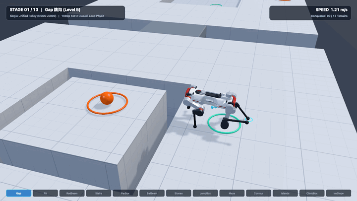
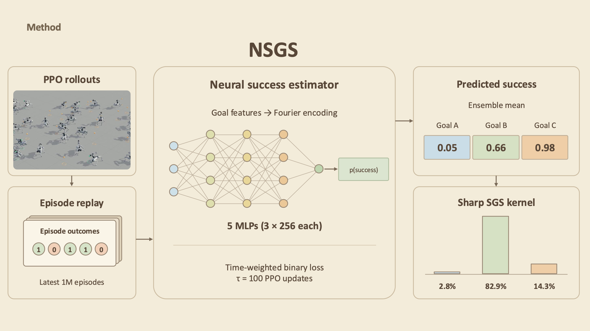
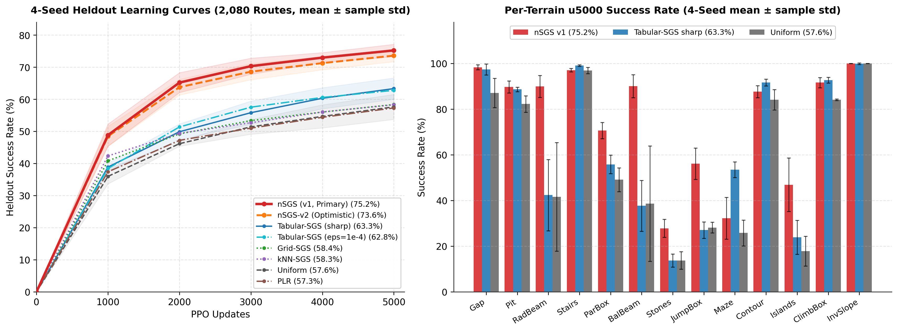

# nSGS

**Neural Success-Guided Sampling for Scalable Reinforcement Learning Curricula**

English · [简体中文](README.zh-CN.md)

`nSGS` is a neural success-rate estimator for large-scale reinforcement learning curricula (100k to 1M+ continuous tasks). Each naturally completed rollout supplies a binary success or failure label; a lightweight MLP ensemble generalizes those outcomes across unseen task descriptors to predict each task's success probability under the current policy, and feeds the predictions into a Success-Guided Sampling (SGS) frontier kernel. This replaces per-task tabular counters that stall under sparse visitation and spatial grids that degrade in high-dimensional or heterogeneous task spaces.

## ANYmal-D 13-Terrain 3D Trimesh Benchmark (4 Paired Seeds)

On a 260-tile 3D Trimesh obstacle-navigation benchmark (13 procedural terrains, **104,000** training routes, **2,080** disjoint full-cross holdout routes, 5,000 PPO updates, 4 paired seeds with identical `u0` initial policy weights per seed), we compare **8 task-curriculum samplers** under a shared `nsgs.baselines` interface. All dispersion metrics below report **unbiased sample standard deviation (`ddof = 1`, `n = 4`)**.

| Rank | Method | 4-Seed Holdout Success (mean ± sample std) | Mean Routes (/2080) | Clean Success (mean ± sample std) | Ref. Wall Time* |
| :--- | :--- | :---: | :---: | :---: | :---: |
| **1** | **`nSGS` (v1, Primary)** | **`75.20% ± 1.91%`** | **`1564.2`** | **`72.42% ± 3.68%`** | `3.26 h` |
| 2 | `nSGS-v2` (Optimistic ablation) | `73.58% ± 1.88%` | `1530.5` | `63.59% ± 15.37%` | `3.45 h` |
| 3 | `Tabular-SGS (sharp)` | `63.31% ± 3.32%` | `1316.8` | `62.01% ± 3.26%` | `3.44 h` |
| 4 | `Tabular-SGS (eps=1e-4)` | `62.76% ± 7.17%` | `1305.5` | `59.98% ± 6.49%` | `3.41 h` |
| 5 | `Grid-SGS` | `58.35% ± 5.03%` | `1213.8` | `56.92% ± 4.86%` | `3.48 h` |
| 6 | `kNN-SGS` | `58.28% ± 4.18%` | `1212.2` | `56.85% ± 3.75%` | `3.47 h` |
| 7 | `Uniform` | `57.61% ± 3.88%` | `1198.2` | `56.47% ± 3.60%` | `3.38 h` |
| 8 | `PLR` | `57.28% ± 4.64%` | `1191.5` | `55.83% ± 4.49%` | `3.37 h` |

- **Primary method choice (`nSGS` v1 vs `nSGS-v2`)**: Both neural variants beat all six non-neural baselines on **4 / 4 seeds** (`+11.89 pp` over `Tabular-SGS sharp`, `+17.59 pp` over `Uniform`, `+17.92 pp` over `PLR`). We designate **`nSGS` (v1)** as the primary method because it achieves both higher mean holdout success (`75.20%` vs `73.58%`) and consistently high Clean posture success (`72.42% ± 3.68%`), whereas `nSGS-v2` exhibits a clear single-seed Clean failure on `seed 73205` (`71.97%` total success vs `41.30%` Clean success due to late-stage midline hind-foot tucking).
- **\*Wall-clock time caveat**: Each method ran on a fixed GPU index (`GPU 0..7`) on a shared 8-GPU node; wall-clock hours are reported for reference only and should not be interpreted directly as controlled algorithmic compute-efficiency benchmarks.
- Full per-seed, per-checkpoint, and per-terrain records are in [four_seed_u5000_summary.json](results/sgs_13terrain_trimesh/four_seed_u5000_summary.json) and [experiments/sgs_13terrain_trimesh](experiments/sgs_13terrain_trimesh/).

## Experiment Source Code

- [Unified 8-method curriculum sampler library (`nsgs.baselines`)](docs/baselines.md)
- [ANYmal-D 13-terrain 3D Trimesh 8-method x 4-seed benchmark](experiments/sgs_13terrain_trimesh/)
- [SGS navigation on 13 procedural terrains with ANYmal-D (initial snapshot)](experiments/sgs_anymal_d/)
- [Go2 and Piper end-effector goal reaching, original 3D and fixed 5D](experiments/go2_piper_goalreach/)

## Goal Reaching on a Million-Task Pool (Go2 + Piper)

On a fixed pool of 1,048,576 three-dimensional loco-manipulation goal configurations, a neural success estimator reached **98.51% walking success** and **98.50% equal-weight coverage across 42 cells** on seed 43, whereas a per-configuration table scored 0% on both metrics (8,000 PPO updates, 2,016 fixed evaluation tasks). A 16^3 spatial grid table also solved the 3D pool and crossed the 50% threshold earlier (update 2,400 vs 5,600), motivating the higher-dimensional 13-terrain Trimesh benchmark above where spatial grids degrade (`58.35%` vs `75.20%`). Earlier implementations and results are documented in [docs/experiments.md](docs/experiments.md).

## Acknowledgements

This research builds on:

- [A Balanced Data Diet (SGS)](https://arxiv.org/abs/2610.12465v1)
- [LeggedManip_Lab](https://github.com/zzzJie-Robot/LeggedManip_Lab)
- [Isaac Lab](https://github.com/isaac-sim/IsaacLab)
- [RSL-RL](https://github.com/leggedrobotics/rsl_rl)

All experiments reported here are conducted in simulation.

## License

Original code is released under [Apache-2.0](LICENSE). Upstream implementations and external robot assets remain subject to their respective licenses. See [THIRD_PARTY.md](THIRD_PARTY.md), [NOTICE](NOTICE), and [LICENSES](LICENSES).
