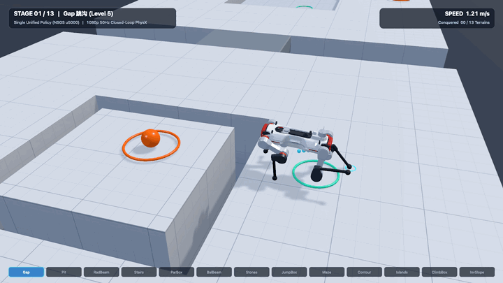
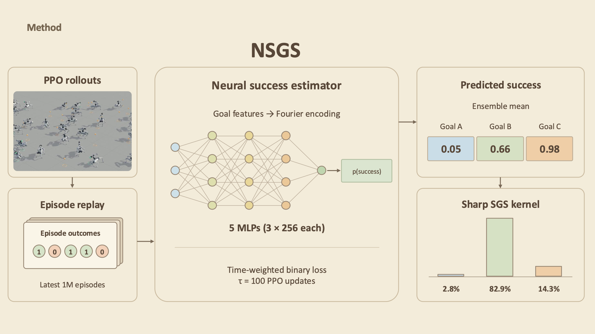
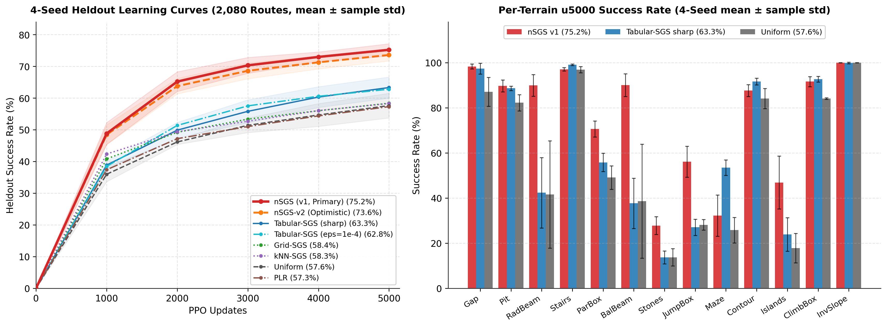

# nSGS

**面向可扩展强化学习课程的神经成功引导采样**

[English](README.md) · 简体中文

`nSGS`（Neural Success-Guided Sampling）是一种面向大规模强化学习任务池（10 万至 100 万以上连续任务）的神经成功率估计与课程采样框架。每个自然结束的训练回合提供一个二值成功/失败标签；轻量级多层感知机集成网络在连续任务特征上跨任务泛化预测当前策略的成功率，并输入成功引导采样（SGS）前沿核以聚焦学习前沿。这一机制克服了逐任务查表在大任务池中访问稀疏导致的停滞，以及空间网格分桶在高维/异构任务空间中的维数灾难。

## ANYmal-D 十三地形 3D Trimesh 四种子正式基准

在 260 块三维三角网格地形（13 类程序化障碍、**104,000** 条训练路线、**2,080** 条与训练集零重叠的纯跨障留出路线、5,000 次 PPO 更新、4 组配对随机种子且同种子共享相同 `u0` 初始策略权重）上，我们在统一 `nsgs.baselines` 接口下系统对比了 **8 种课程采样器**。下表所有离散度均采用**无偏样本标准差（`ddof = 1`, `n = 4`）**。

| 排名 | 方法 | 四种子留出成功率 (mean ± 样本标准差) | 平均通过路线 (/2080) | Clean 成功率 (mean ± 样本标准差) | 参考训练耗时* |
| :--- | :--- | :---: | :---: | :---: | :---: |
| **1** | **`nSGS` (v1, 主方法)** | **`75.20% ± 1.91%`** | **`1564.2`** | **`72.42% ± 3.68%`** | `3.26 h` |
| 2 | `nSGS-v2` (乐观探索消融) | `73.58% ± 1.88%` | `1530.5` | `63.59% ± 15.37%` | `3.45 h` |
| 3 | `Tabular-SGS (sharp)` | `63.31% ± 3.32%` | `1316.8` | `62.01% ± 3.26%` | `3.44 h` |
| 4 | `Tabular-SGS (eps=1e-4)` | `62.76% ± 7.17%` | `1305.5` | `59.98% ± 6.49%` | `3.41 h` |
| 5 | `Grid-SGS` | `58.35% ± 5.03%` | `1213.8` | `56.92% ± 4.86%` | `3.48 h` |
| 6 | `kNN-SGS` | `58.28% ± 4.18%` | `1212.2` | `56.85% ± 3.75%` | `3.47 h` |
| 7 | `Uniform` | `57.61% ± 3.88%` | `1198.2` | `56.47% ± 3.60%` | `3.38 h` |
| 8 | `PLR` | `57.28% ± 4.64%` | `1191.5` | `55.83% ± 4.49%` | `3.37 h` |

- **主方法选择（`nSGS` v1 vs `nSGS-v2`）**：两种神经采样器在 **4 / 4 种子上全部领先全部 6 个非神经基线**（`nSGS` v1 领先最强基线 `Tabular-SGS sharp` `+11.89 pp`，领先 `Uniform` `+17.59 pp`，领先 `PLR` `+17.92 pp`）。我们将 **`nSGS` (v1)** 定为主方法：不仅四种子总成功率更高（`75.20%` vs `73.58%`），而且 Clean 姿态成功率高度稳定（`72.42% ± 3.68%`）；相比之下，`nSGS-v2` 在 `seed 73205` 上出现明显的 Clean 失败案例（普通成功率 `71.97%`，Clean 成功率跌至 `41.30%`，源于后期单种子姿态内收）。
- **\*耗时口径说明**：8 种方法在共享 8 卡节点上分别运行于固定 GPU 编号（`GPU 0..7`），此处训练耗时仅作参考，不直接等价于受控条件下的算法计算效率对比。
- 完整逐种子、逐检查点与 13 地形分项结果见 [four_seed_u5000_summary.json](results/sgs_13terrain_trimesh/four_seed_u5000_summary.json) 与 [experiments/sgs_13terrain_trimesh](experiments/sgs_13terrain_trimesh/)。

## 实验代码

- [统一 8 方法课程采样器库（`nsgs.baselines`）](docs/baselines.md)
- [ANYmal-D 十三地形 3D Trimesh 8 方法 × 4 种子正式基准](experiments/sgs_13terrain_trimesh/)
- [ANYmal-D 十三地形 SGS 导航（早期快照）](experiments/sgs_anymal_d/)
- [Go2＋Piper 末端到达，原三维与固定五维](experiments/go2_piper_goalreach/)

## 百万任务池上的目标到达实验（Go2 + Piper）

在由距离、方位和高度定义的 1,048,576 个全身控制目标配置上，seed 43 的神经成功率估计器取得 **98.51% 的行走成功率**和 **98.50% 的 42 格等权覆盖**，逐配置查表的两项结果均为 0%（8,000 次 PPO 更新、2,016 项固定评估任务）。按空间位置共享数据的 16³ 格子表在低维三维池中同样学会了任务并更早达标（第 2,400 次 vs 第 5,600 次更新），这也正是推动我们进一步构建上述高维十三地形三维网格基准的动机——在异构高维任务空间中，空间网格（`58.35%`）显著落后于 `nSGS`（`75.20%`）。此前实验的实现与结果见[实验历史](docs/experiments.md)。

研究基于 [SGS](https://arxiv.org/abs/2610.12465v1)、[LeggedManip_Lab](https://github.com/zzzJie-Robot/LeggedManip_Lab)、[Isaac Lab](https://github.com/isaac-sim/IsaacLab) 与 [RSL-RL](https://github.com/leggedrobotics/rsl_rl)。全部结果来自仿真。原创代码采用 [Apache-2.0](LICENSE)，上游代码与资产遵循各自许可，见 [第三方声明](THIRD_PARTY.md)。
