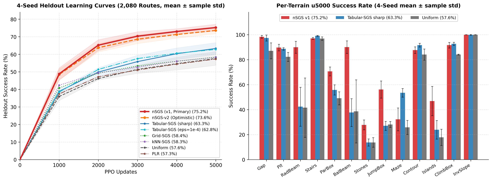

# ANYmal-D 13-Terrain 3D Trimesh Goal Navigation Benchmark

This directory contains the 1:1 3D Trimesh ANYmal-D goal-navigation benchmark across **13 procedural obstacle terrains** (`gap`, `pit`, `radial_beam`, `stairs`, `parallel_box`, `balance_beam`, `stepping_stones`, `jump_box`, `maze`, `contour`, `islands`, `climb_box`, `inverted_slope`) comparing **8 task-curriculum samplers** over **4 paired random seeds** (`s73205`, `s10001`, `s20261`, `s30307`) with identical `u0` initial policy weights per seed.

## Benchmark Setup and Exact Hyperparameters

- **Task pool (`catalog_v4`, `v6` continuous terrains)**: 260 3D Trimesh tiles (`13 terrains x 2 seeds x 10 difficulty levels`), **104,000** training routes (`10%` Tier-0 Easy, `35%` Tier-1 Cross-Edge Bridge, `55%` Tier-2 Full Cross) and **2,080** disjoint pure full-cross holdout routes (`160 / terrain`, zero endpoint overlap with training).
- **Policy and recipe (`recipe-13t-v6-agile`)**: Bounded heteroscedastic Gaussian PPO (`4,096` parallel envs, `5,000` updates, `24` steps/update, `50 Hz` control), asymmetric arrival/drop terminals, and forward height scan `[-0.75, +1.45]m x [-0.70, +0.70]m`.
- **Exact sampler configurations in [trimesh_train.py](src/trimesh_train.py)** (noting explicit experiment overrides relative to library defaults in [docs/baselines.md](../../docs/baselines.md)):
  - `nsgs` **(Primary, v1)**: 5-MLP ensemble `(256, 256, 256)`, `history_limit=1_000_000`, `tau=100`, `sharp` kernel (`t=0.66, k=5.0, eps=1e-8`), `optimizer_steps=20`, `batch_size=4096`, `cold_updates=20`, `sampler_update_every=5`.
  - `nsgs_v2` **(Optimistic ablation)**: Overrides the generic library defaults (`history_limit=200_000, tau=30`) in `trimesh_train.py` lines 71–76 with `history_limit=1_000_000`, `tau=120.0`, `beta_optimism=0.30`, `adaptive_target=True`, and `SGSKernel(target=0.66, concentration=5.0, temperature=2.0, epsilon=1e-5, uniform_floor=0.0)` to match the 104k-task pool capacity and 5,000-update horizon.
  - `tabular_sgs_sharp`: `history=100`, `sharp` kernel (`t=0.66, k=5.0, eps=1e-8`).
  - `tabular_sgs_eps1e4` (`tabular_sgs_default`): `history=100`, `default` kernel (`t=0.50, k=1.0, eps=1e-4`).
  - `grid_sgs`: sparse active-cell grid, `history=100`, `sharp` kernel.
  - `knn_sgs`: `k=32`, `tau=50.0`, `history_limit=100_000`, `max_anchors=16_384`, `sharp` kernel, `sampler_update_every=5`.
  - `uniform`, `plr`: standard `nsgs.baselines` configurations.

## Four-Seed Results (`u5000`, 2,080 Holdout Routes)

All dispersion metrics below report **unbiased sample standard deviation (`ddof = 1`, `n = 4` seeds)**. Full per-seed, per-checkpoint, and per-terrain records are saved in [four_seed_u5000_summary.json](../../results/sgs_13terrain_trimesh/four_seed_u5000_summary.json).



| Rank | Method | 4-Seed Holdout Success (mean ± sample std) | Mean Routes (/2080) | Clean Success (mean ± sample std) | Ref. Wall Time* |
| :--- | :--- | :---: | :---: | :---: | :---: |
| **1** | **`nsgs` (v1, Primary)** | **`75.20% ± 1.91%`** | **`1564.2`** | **`72.42% ± 3.68%`** | `3.26 h` |
| 2 | `nsgs_v2` (Optimistic ablation) | `73.58% ± 1.88%` | `1530.5` | `63.59% ± 15.37%` | `3.45 h` |
| 3 | `tabular_sgs_sharp` | `63.31% ± 3.32%` | `1316.8` | `62.01% ± 3.26%` | `3.44 h` |
| 4 | `tabular_sgs_eps1e4` | `62.76% ± 7.17%` | `1305.5` | `59.98% ± 6.49%` | `3.41 h` |
| 5 | `grid_sgs` | `58.35% ± 5.03%` | `1213.8` | `56.92% ± 4.86%` | `3.48 h` |
| 6 | `knn_sgs` | `58.28% ± 4.18%` | `1212.2` | `56.85% ± 3.75%` | `3.47 h` |
| 7 | `uniform` | `57.61% ± 3.88%` | `1198.2` | `56.47% ± 3.60%` | `3.38 h` |
| 8 | `plr` | `57.28% ± 4.64%` | `1191.5` | `55.83% ± 4.49%` | `3.37 h` |

- **Known `nsgs_v2` failure case (`seed 73205`)**: On `seed 73205`, `nsgs_v2` achieved `71.97%` total success (`1,497 / 2,080`) but dropped to `41.30%` Clean success (`859 / 2,080`) due to a late-stage midline hind-foot tucking attractor (`LH_FOOT y_b <= 0` on 594 routes), whereas on `seed 10001` it reached `72.60%` Clean (`0` tucked routes). Because **`nsgs` (v1)** maintains high Clean rates across all 4 seeds (`72.42% ± 3.68%`) with higher total success (`75.20% ± 1.91%`) and fewer hyperparameters, **`nsgs` (v1)** is our primary method.
- **\*Wall-clock time note**: Methods were executed on fixed GPU slots (`GPU 0..7`) on a shared 8-GPU node; wall-clock durations are logged for reference rather than controlled algorithmic compute-efficiency comparisons.

## Source Files

| Component | Files |
| :--- | :--- |
| 13 procedural 3D Trimesh terrains (`v3` and `v6`) | [trimesh_terrains.py](src/trimesh_terrains.py) |
| 3-tier continuous task catalog generator (`catalog_v4`) | [build_catalog_v4.py](src/build_catalog_v4.py), [build_catalog.py](src/build_catalog.py) |
| Isaac Lab batched physics scene, observations, and rewards | [trimesh_scene.py](src/trimesh_scene.py), [navigation.py](src/navigation.py) |
| Bounded heteroscedastic PPO and multi-baseline trainer | [ppo_smoke.py](src/ppo_smoke.py), [trimesh_train.py](src/trimesh_train.py) |
| Deterministic 2,080-route evaluation and gait diagnostics | [eval_haa_full.py](src/eval_haa_full.py), [diagnostics.py](src/diagnostics.py), [gait_observables_v1.py](src/gait_observables_v1.py) |
| Shared 8-method sampler library | [src/nsgs/baselines](../../src/nsgs/baselines/) |

## Reproduction

Requires Isaac Sim 5.1, Isaac Lab, and RSL-RL.

```bash
# 1. Build the frozen 260-tile v6 catalog (104,000 train + 2,080 holdout routes)
python experiments/sgs_13terrain_trimesh/src/build_catalog_v4.py

# 2. Train nSGS (swap --method for uniform, plr, tabular_sgs_sharp, tabular_sgs_default, grid_sgs, knn_sgs, nsgs_v2)
python experiments/sgs_13terrain_trimesh/src/trimesh_train.py \
  --catalog experiments/sgs_13terrain_trimesh/catalog_v4 \
  --method nsgs \
  --seed 73205 \
  --updates 5000 \
  --num-envs 4096 \
  --recipe recipe-13t-v6-agile \
  --out runs/s73205/nsgs

# 3. Run deterministic 2,080-route heldout evaluation
python experiments/sgs_13terrain_trimesh/src/eval_haa_full.py \
  --catalog experiments/sgs_13terrain_trimesh/catalog_v4 \
  --checkpoint runs/s73205/nsgs/checkpoint-5000.pt \
  --recipe recipe-13t-v6-agile \
  --out runs/s73205/nsgs/eval_haa_full-u5000
```
